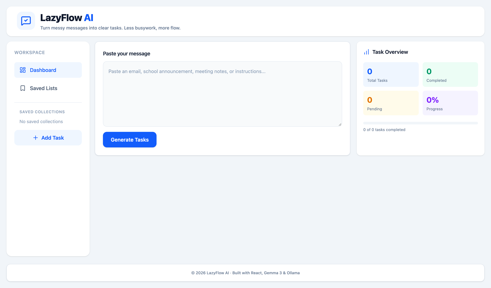
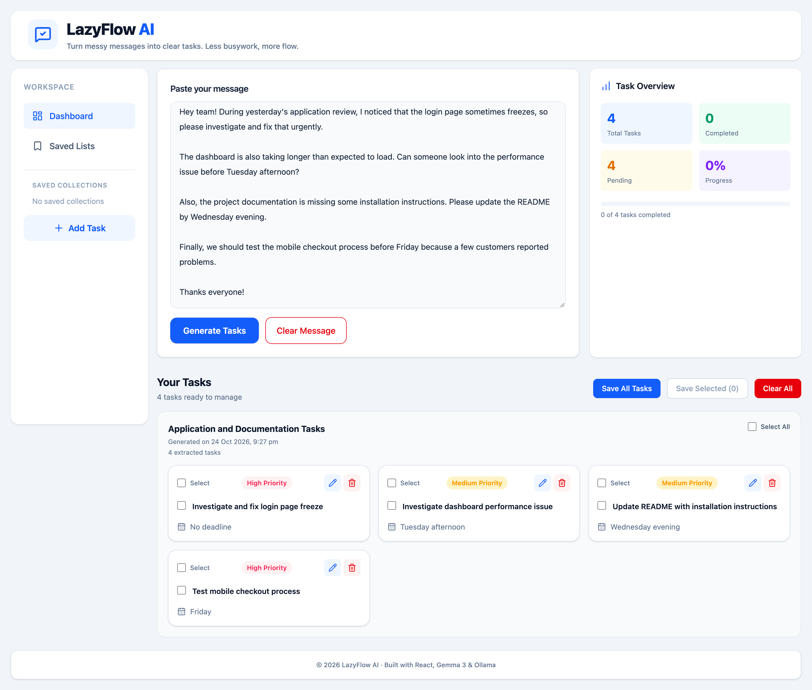
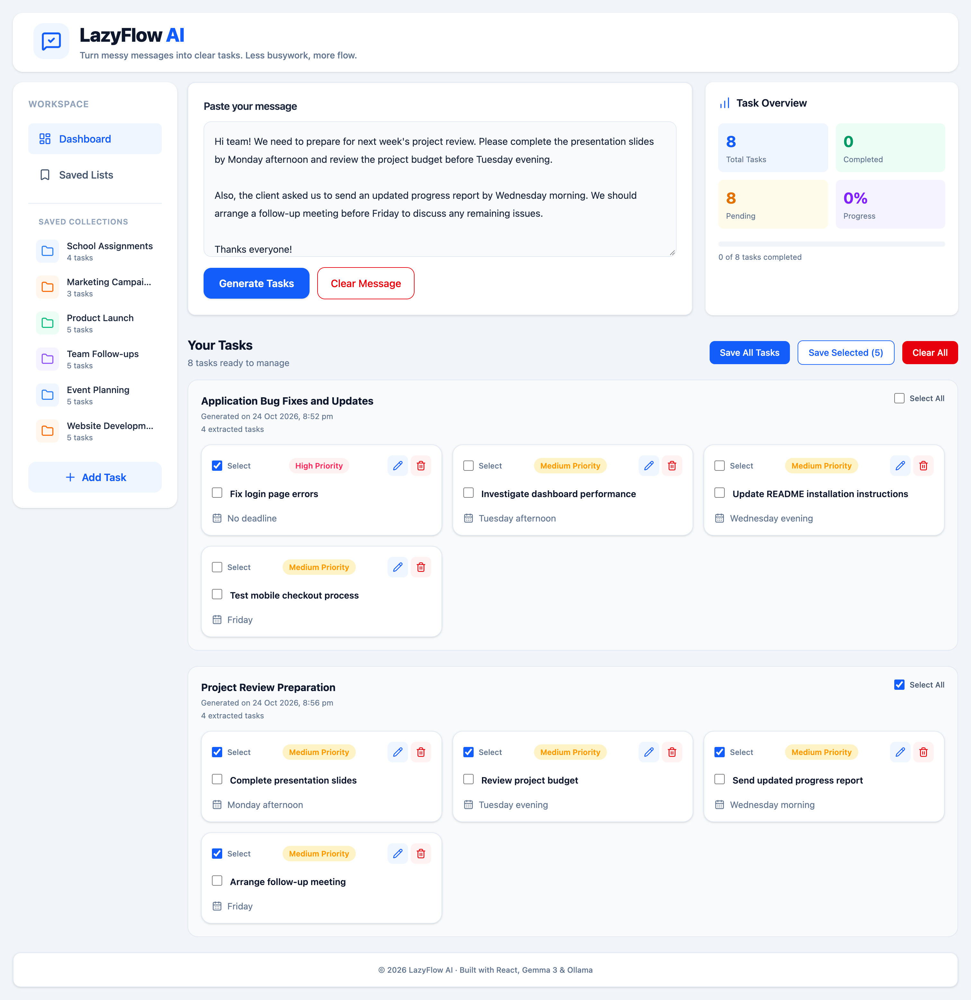
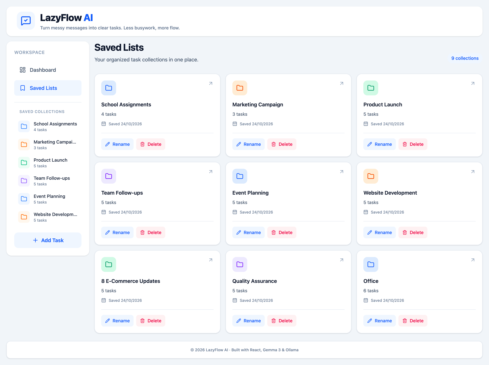
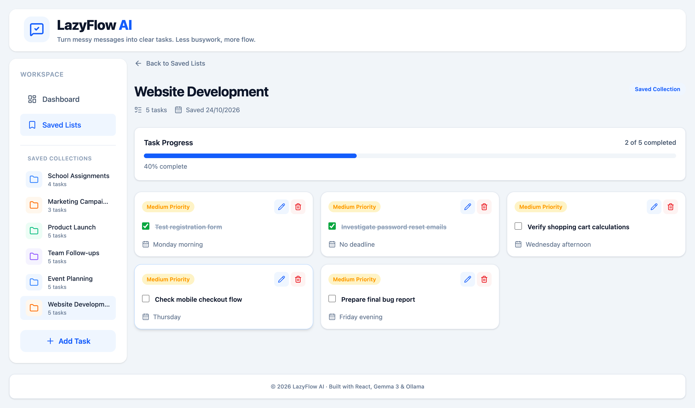

# LazyFlow AI

**Turn messy messages into organized, actionable tasks using local AI.**

LazyFlow AI is a full-stack, AI-powered task management MVP that transforms unstructured messages into actionable tasks using Google's Gemma 3 model running locally through Ollama.

Users can extract, organize, prioritize, edit, complete, and save tasks through an interactive dashboard.

## Features

- **AI Task Extraction:** Extract actionable tasks from unstructured messages.
- **Smart Task Grouping:** Generate meaningful group headings for each message.
- **Priority & Deadline Detection:** Identify deadlines and task priorities from message context.
- **Task Management:** Add, edit, delete, select, and complete tasks.
- **Saved Collections:** Organize tasks into named collections with rename and delete functionality.
- **Progress Tracking:** View completed and pending tasks.
- **Duplicate Detection:** Prevent repeated processing of previously extracted messages.
- **Local Persistence:** Save tasks and collections in browser localStorage.
- **Local AI Processing:** Run Gemma 3 through Ollama without a cloud AI API.

## Tech Stack

| Layer         | Technologies                     |
| ------------- | -------------------------------- |
| Frontend      | React 19, Vite 8, Tailwind CSS 4 |
| Routing       | React Router 7                   |
| Icons         | Lucide React                     |
| Backend       | Node.js, Express 5               |
| AI Model      | Gemma 3 4B                       |
| Model Runtime | Ollama                           |
| Storage       | Browser localStorage             |

## Screenshots

### Dashboard

A clean dashboard to paste messages, generate tasks using AI, and track overall task progress.



### AI Task Extraction

LazyFlow AI analyzes unstructured messages using Gemma 3 and extracts actionable tasks with priorities, deadlines, and meaningful group headings.



### Task Group Selection

Tasks extracted from different messages are organized into separate groups. Users can select individual tasks or use **Select All** to select an entire group, then save only the selected tasks into a collection.

Unselected tasks remain on the Dashboard, allowing users to organize tasks across different collections.



### Saved Collections

Create and manage named collections to organize tasks by project, activity, or category. Collections can also be renamed or deleted.



### Saved Collection Details

Open a saved collection to view its tasks, mark tasks as completed, edit or delete tasks, and track completion progress.



## Getting Started

### Prerequisites

- Node.js (a version compatible with Vite 8)
- npm
- Ollama installed locally
- Gemma 3 4B model downloaded

### 1. Clone the repository

```bash
git clone https://github.com/ThanziaPatelRaheem/lazyflow-ai.git
cd lazyflow-ai
```

### 2. Install and prepare Ollama

Download Ollama from https://ollama.com.

Download the AI model:

```bash
ollama pull gemma3:4b
```

Ensure Ollama is running before generating tasks.

### 3. Backend setup

```bash
cd server
npm install
cp .env.example .env
```

Default environment configuration:

```env
PORT=3000
OLLAMA_BASE_URL=http://localhost:11434
OLLAMA_MODEL=gemma3:4b
```

Start the backend:

```bash
npm run dev
```

Backend URL: http://localhost:3000

Status endpoint: http://localhost:3000/api/status

### 4. Frontend setup

Open another terminal:

```bash
cd client
npm install
npm run dev
```

Open the local URL displayed by Vite, typically http://localhost:5173.

### 5. Use LazyFlow AI

1. Paste a message containing tasks or reminders.
2. Click **Generate Tasks**.
3. Review the extracted tasks, priorities, and deadlines.
4. Edit, complete, or select tasks as needed.
5. Save tasks into named collections.

## How It Works

1. The user submits an unstructured message through the React frontend.
2. The Express backend sends the message and extraction instructions to Ollama.
3. Gemma 3 identifies actionable tasks and generates a relevant group heading.
4. The backend validates the structured JSON response.
5. React displays the extracted tasks on the dashboard.
6. Tasks and collections are stored locally in the browser.

## Current Limitations

- Requires Ollama and Gemma 3 to run locally.
- Data is stored in browser localStorage rather than a database.
- No user authentication or synchronization between devices.
- AI-generated priorities and deadlines may require user review.
- No publicly hosted demo is currently provided.

## Future Improvements

- Cloud-hosted AI inference and deployment.
- Database-backed storage and user accounts.
- Calendar integration and task reminders.
- Automated testing and CI/CD.
- Task ownership and collaboration.

## Project Status

**Functional MVP — Built for Hacktoberfest 2026**

LazyFlow AI demonstrates full-stack development and local AI integration using an open-weight language model.
